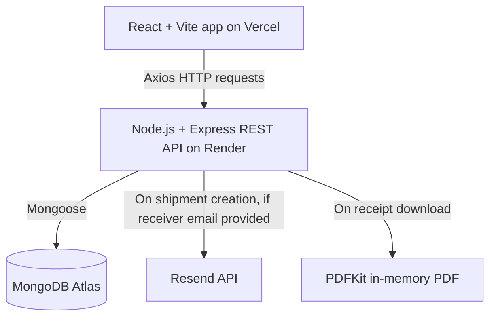

# Shipment Tracker

A full-stack web application for creating and managing shipments, tracking deliveries by tracking number, notifying receivers by email, and downloading PDF receipts.

**Live demo:** https://shipment-tracker-hazel-mu.vercel.app

> The backend runs on Render's free tier, so the first request after a period of inactivity can take 30-60 seconds while the server wakes up.

## Features

- **Authentication:** register and log in with JWT-based sessions and bcrypt-hashed passwords.
- **Create shipments:** enter receiver, address, city, parcel weight and parcel type; a unique tracking number (`SHP-<timestamp>-<random>`) is generated automatically.
- **Manage shipments:** view your own shipments, open shipment details, and cancel a shipment.
- **Dashboard statistics:** shipment counts by status, computed with MongoDB aggregation.
- **Public tracking:** anyone can look up a shipment and its status history by tracking number, with no login required.
- **Email notifications:** when a shipment is created with a receiver email, the receiver gets an email with a tracking link (via Resend).
- **PDF receipts:** download a receipt for a shipment, generated on the fly with PDFKit.
- **Error handling:** centralized Express error middleware, and an Axios interceptor that redirects to login on expired or invalid sessions.

## Architecture



## Tech Stack

| Layer | Technology |
| --- | --- |
| Frontend | React 19, Vite, React Router DOM, Axios, Tailwind CSS (selected pages) |
| Backend | Node.js 22, Express 5 |
| Database | MongoDB Atlas, Mongoose |
| Authentication | JSON Web Tokens (`jsonwebtoken`), `bcryptjs` |
| Email | Resend |
| PDF | PDFKit |
| Hosting | Vercel (frontend), Render (backend), MongoDB Atlas (database) |
| Tooling | `nodemon` (backend dev), ESLint (frontend) |

## Project Structure

```text
shipment-tracker/
├── backend/
│   ├── server.js
│   ├── config/          # Database connection
│   ├── models/          # User, Shipment, ShipmentHistory
│   ├── controllers/     # auth, shipment, track
│   ├── routes/          # authRoutes, shipmentRoutes, trackRoutes
│   ├── middleware/      # auth (JWT) and error handling
│   └── utils/           # Email sending, PDF receipt generation
└── frontend/
    ├── vercel.json      # SPA rewrite so deep links work on Vercel
    └── src/
        ├── api/         # Axios instance and interceptors
        ├── context/     # AuthContext
        ├── components/  # PrivateRoute
        └── pages/       # Login, Register, Home, TrackPage, sender/*, tracker/*
```

## Getting Started

### Prerequisites

- Node.js 20.19+ (22 recommended) and npm
- A MongoDB Atlas cluster (or any MongoDB connection string)
- A [Resend](https://resend.com) API key (only needed for email notifications)

### 1. Clone the repository

```bash
git clone https://github.com/Khushaal22/Shipment-Tracker.git
cd Shipment-Tracker
```

### 2. Configure the backend

```bash
cd backend
npm install
```

Create `backend/.env`:

```dotenv
PORT=5000
MONGO_URI=<your-mongodb-connection-string>
JWT_SECRET=<a-long-random-secret>
JWT_EXPIRES_IN=7d
RESEND_API_KEY=<your-resend-api-key>
CLIENT_URL=http://localhost:5173
```

Start the server:

```bash
npm run dev     # development, with nodemon
npm start       # plain node
```

The API runs at `http://localhost:5000`. Health check: `GET http://localhost:5000/api/health` should return `{"status":"OK","message":"server is running"}`.

### 3. Configure the frontend

In a second terminal:

```bash
cd frontend
npm install
```

Create `frontend/.env`:

```dotenv
VITE_API_BASE_URL=http://localhost:5000/api
```

Start the dev server:

```bash
npm run dev
```

The app runs at `http://localhost:5173`.

Other frontend scripts: `npm run build` (production build), `npm run preview` (serve the build), `npm run lint`.

> **Never commit real `.env` files.** Keep secrets out of version control.

## Deployment

The app is deployed as three parts: MongoDB Atlas (database), Render (backend) and Vercel (frontend).

### Backend on Render (Web Service)

- Root directory: `backend`
- Build command: `npm install`
- Start command: `npm start`
- Environment variables: `MONGO_URI`, `JWT_SECRET`, `JWT_EXPIRES_IN`, `RESEND_API_KEY`, `CLIENT_URL` (the deployed frontend URL, no trailing slash) and `NODE_VERSION=22`
- Do not set `PORT`; Render provides it.
- MongoDB Atlas Network Access must allow Render's outbound traffic (on the free tier, `0.0.0.0/0`).
- Verify the deploy at `https://<your-service>.onrender.com/api/health`.

### Frontend on Vercel

- Root directory: `frontend`, framework preset: Vite
- Environment variable: `VITE_API_BASE_URL=https://<your-service>.onrender.com/api` (set before building, because Vite embeds it at build time)
- `frontend/vercel.json` rewrites every route to `index.html`, so direct links such as `/track/<tracking-number>` work.

## Application Flow

1. A user registers or logs in and is redirected to `/home`.
2. `/home` offers two options:
   - **Create Shipment** → `/sender/dashboard`: statistics, create a shipment, list your shipments, view details, cancel, download a receipt.
   - **Track Shipment** → `/tracker/dashboard`: look up a shipment by tracking number.
3. Any logged-in user can use both dashboards; there are no role-restricted routes.
4. Public tracking works without logging in at `/track` and `/track/:trackingNumber`. These links are the ones included in notification emails.

## API Reference

Base URL: `/api`

| Method | Endpoint | Auth | Description |
| --- | --- | --- | --- |
| GET | `/health` | Public | Health check |
| POST | `/auth/register` | Public | Register a new user |
| POST | `/auth/login` | Public | Log in and receive a JWT |
| GET | `/auth/me` | JWT | Get the current user |
| GET | `/shipments/stats` | JWT | Dashboard statistics |
| GET | `/shipments/my` | JWT | List the current user's shipments |
| POST | `/shipments` | JWT | Create a shipment |
| GET | `/shipments/:id` | JWT | Get shipment details |
| GET | `/shipments/:id/receipt` | JWT | Download the PDF receipt |
| PATCH | `/shipments/:id/cancel` | JWT | Cancel a shipment |
| GET | `/track/:trackingNumber` | Public | Shipment details and status history |

Protected endpoints expect the JWT in the request's authorization header; the frontend's Axios instance attaches it automatically.

## Shipment Statuses

`pending` → `picked_up` → `in_transit` → `out_for_delivery` → `delivered`, or `cancelled`.

## Known Limitations

- **Status progression:** new shipments start as `pending` and can be cancelled, but there is currently no way to advance a shipment through the later statuses.
- **Email delivery:** Resend's test sender can only deliver to the account owner's email. Sending to arbitrary receivers requires a verified sending domain.
- **Cold starts:** the free Render instance sleeps when idle, so the first request can be slow.
- **Styling:** the UI mixes Tailwind CSS and inline styles.

## Roadmap

- Decide on and implement shipment status updates.
- Verify a sending domain in Resend for production email delivery.

## Author

Khushaal Singh Tanwar